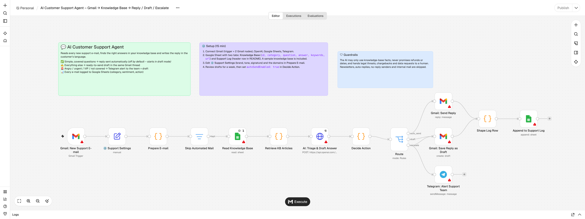

# AI Customer Support Agent (n8n + Gmail + Knowledge Base)

Answers your support inbox from your own knowledge base, in the customer's language. Anything risky goes to a human.



## What it does

1. **Watches your support inbox** (Gmail).
2. **Skips the noise:** newsletters, auto-replies, no-reply senders, bounces and internal e-mails. It strips quoted threads and keeps only the customer's newest message. This works for English, Turkish, German, Spanish and French reply formats.
3. **Finds the right answers.** It runs a keyword search (BM25) over your knowledge base in Google Sheets and passes the top articles to the AI. You don't need a vector database: you edit your answers in a spreadsheet.
4. **AI triage and reply** (OpenAI, strict JSON schema). The AI returns:
   - category (order status, shipping, returns, billing, technical, account, product, sales, complaint, …)
   - urgency, sentiment and language
   - whether the knowledge base covers the question
   - a confidence score
   - a reply in the customer's language
   - a one-line summary for the agent
5. **Guardrails.** The AI may only use knowledge-base facts. It never invents order numbers, dates, prices or refunds. Legal threats, chargebacks and data-deletion requests always go to a human.
6. **Decides the action:**
   - ✅ **Auto-send.** Covered, high-confidence, low-risk categories get an instant reply in the same thread. This is **off by default**: you start in draft mode.
   - ✍️ **Draft.** A ready-to-send reply is saved in the customer's Gmail thread.
   - 🚨 **Escalate.** Angry customers, high urgency, VIP domains, complaints and questions the knowledge base doesn't cover trigger a Telegram alert to the team, plus a draft.
   - 🗑 **Ignore.** Spam.
7. **Logs every e-mail** to a Google Sheet: category, sentiment, action, articles used and confidence. That data shows you which questions to add to the knowledge base next.

## Why businesses buy this

- **First response in minutes instead of hours, at any time of day.**
- **60–80% of repetitive questions** ("where is my order?", "how do I return?", "reset password") are answered from the knowledge base.
- **Humans focus on the hard cases** and get a summary and a suggested reply for each one.
- **Safe rollout.** You review drafts first, then switch on auto-send category by category.

## Setup (≈15 minutes)

1. Import `ai-support-agent.workflow.json` into n8n.
2. Add credentials:
   - **Gmail OAuth2** for the trigger and both Gmail nodes
   - **OpenAI API**
   - **Google Sheets OAuth2**
   - **Telegram API**
3. Create a Google Sheet with two tabs and paste its ID into both Sheets nodes:
   - **`Knowledge Base`**, with header `id,category,question,answer,keywords,url`. You can import `sample-knowledge-base.csv` to start.
   - **`Support Log`**, with this header:

     ```
     received_at,customer_email,customer_name,subject,category,urgency,sentiment,language,action,escalation_reasons,can_answer_from_kb,used_article_ids,ai_confidence,summary_for_agent,reply_body,message_id,thread_id,handled_at
     ```

4. Edit **⚙️ Support Settings** (company, description, tone, response time, signature).
5. In **Prepare E-mail**, set `ownDomains` to your company domain.
6. Put your Telegram chat ID in **Telegram: Alert Support Team**.
7. Activate. After a week of reviewing drafts, set `autoSendEnabled: true` in **Decide Action**. You can also adjust `autoSendCategories`, `minConfidenceAutoSend` and `vipDomains` there.

### Writing good knowledge-base rows

- One question per row. Put the answer in plain language, the way you would write it to a customer.
- Add synonyms and other languages to `keywords` (e.g. `delivery time, kargo, lieferzeit`). This is what lets the search find the right article.
- Check the **Support Log** weekly. Questions marked "Not covered by the knowledge base" are your next rows to add.

## Customisation ideas

- Use Outlook or a shared IMAP inbox instead of Gmail.
- Use Zendesk, Freshdesk, Intercom or Shopify inbox via their n8n nodes or APIs.
- Look up live order status from Shopify or WooCommerce before replying.
- Swap the keyword search for a vector store (Supabase, Pinecone or Qdrant) when the knowledge base grows to hundreds of articles.
- Send alerts to Slack or Teams instead of Telegram.

## Cost

About **$0.001–0.003 per e-mail** with `gpt-4o-mini`.

## Need it set up for your business?

I connect it to your inbox, write your knowledge base and tune the guardrails: **[Fiverr](https://www.fiverr.com/batuhanavcioglu)**.

## Development

`scripts/build_support_workflow.py` generates the workflow JSON, and `scripts/test_support.js` unit-tests every Code node and the AI request body with mock n8n data:

```bash
python3 scripts/build_support_workflow.py && node scripts/test_support.js
```
